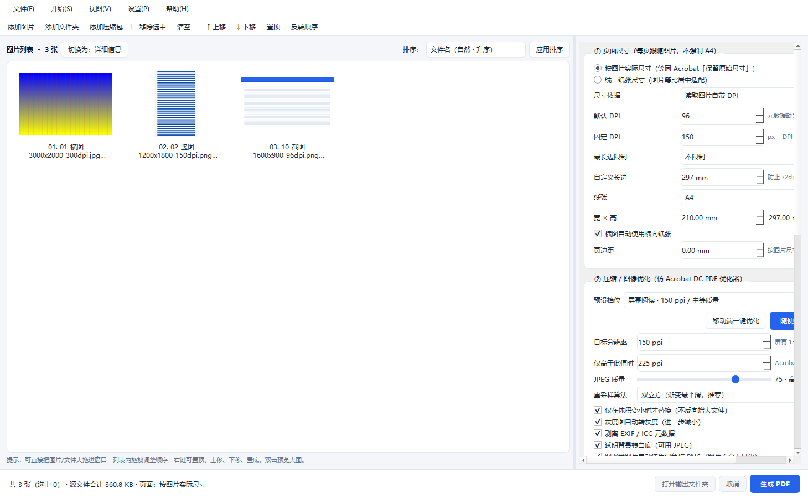

<div align="center">

# ImageToPDF Studio v1.10

**图片按原尺寸转 PDF · Windows 桌面工具 · 中英文 / 明暗主题**
**Batch images → PDF at original page size · Windows desktop app · EN/UI + light/dark theme**


[下载 EXE v1.10](https://github.com/borisKP/ImageToPDF_Studio/releases/download/v1.10/ImageToPDF_Studio_v1.10.exe) · [使用说明](docs/使用说明.html) · [Changelog](CHANGELOG.md) · [全部历史版本 Releases](https://github.com/borisKP/ImageToPDF_Studio/releases) · [English ↓](#english)



</div>

---

## 中文

把图片直接转成 PDF。**页面尺寸跟随每张图片自身尺寸**（不强制 A4），提供类 Acrobat DC 的压缩与口令保护，支持图片 / 文件夹 / 压缩包（含密码）导入。

### 特性

| 能力 | 说明 |
|---|---|
| 页面尺寸 | 读取图片 DPI 元数据，按 `px ÷ DPI × 72 = pt` 生成页面；横图横页、竖图竖页、每页尺寸可不同。另支持固定 DPI、最长边限制、统一 A4/A3/自定义纸张 |
| 导入 | 图片、文件夹、ZIP / 7Z / RAR 压缩包；支持拖放 |
| 加密压缩包 | AES 加密 ZIP、带密码 7Z；密码弹窗输入，本次会话记住。RAR 需本机装有 7-Zip 或 WinRAR |
| 排序 | 文件名自然排序、修改时间、大小、扩展名；列表拖拽、右键置顶/上移/下移/置底、仅选中项排序 |
| 视图 | 预览小图 ⇄ 纯文字详细信息（9 列：尺寸、DPI、页面尺寸、体积、修改时间、路径） |
| 压缩 | 双立方下采样 + baseline JPEG + 图形类图片调色板 PNG + 仅在体积减小时替换；屏幕/均衡/印刷/极限/自定义档 |
| 阅读优化 | 「阅读流畅优先」统一预处理为 baseline JPEG；单页像素上限；「移动端一键优化」「随便看看 · 最小最快」两个一键档 |
| PDF 安全 | AES-256 / AES-128 / RC4-128，打开密码 + 所有者密码 + 打印/复制/修改/注释权限 |
| 其它 | 按文件名写书签、后台转换与取消、双击预览、进度条、顶部横栏菜单与「关于」对话框 |
| 语言 / 主题（v1.9） | 「设置 → 语言」中文 / English 即时切换；「设置 → 外观」浅色 / 深色 / 跟随系统，选择持久保存。加新语言只需在 `src/i18n.py` 增加词典条目 |

### 快速开始

```bat
:: 方式一：直接运行（推荐，免 Python 环境）
下载 Releases 里的 ImageToPDF_Studio_v1.10.exe，双击运行
:: SmartScreen 拦截：右键 → 属性 → 解除锁定，或 更多信息 → 仍要运行

:: 方式二：从源码运行
git clone https://github.com/borisKP/ImageToPDF_Studio.git
cd ImageToPDF_Studio
python -m pip install -r requirements.txt
python src/app.py

:: 方式三：自己打包（含版本同步）
build.bat
```

无窗口自检：`python src/app.py --selftest`（生成 `_selftest.txt`，检查全部依赖链路）

### 使用要点

1. 文件 → 添加图片 / 添加文件夹 / 添加压缩包，或直接拖进窗口。
2. 一步出文件：文件 → 导入压缩包并直接生成 PDF。
3. 只求快速翻看：「随便看看 · 最小最快」（96 ppi / 质量 55 / 最长边 210 mm / 单页 ≤1 MP）。
4. 兼顾画质：「移动端一键优化」（120 ppi / 质量 70 / 最长边 297 mm / ≤4 MP）。
5. 设置「③ 输出位置与文件名」→ 点「生成 PDF」。

> 图片网站之所以流畅，是因为下发的是 1200 px 展示副本（约为 10 MB 原图的 2%）。PDF 没有服务端，必须在生成时就把图片降维到展示尺寸。只调 JPEG 质量而页面仍是几十英寸，几乎没用。

完整说明：[`docs/使用说明.html`](docs/使用说明.html)（浏览器打开）

### 压缩包支持

| 格式 | 密码 | 依赖 | 备注 |
|---|---|---|---|
| ZIP（Store/Deflate） | 否 | 内置 | 标准库 / pyzipper |
| ZIP（ZipCrypto / WinZip AES） | 是 | 内置 pyzipper | 弹窗输入密码 |
| 7Z | 是 | 内置 py7zr | 含文件名加密也可（需密码） |
| RAR / RAR5 | 是 | **外部** 7-Zip 或 WinRAR | 未安装时给出明确提示；ZIP/7Z 无需外部工具 |

解压安全限制：仅提取图片、跳过隐藏文件与目录穿越、单文件 ≤100 MB、最多 500 张。总体积默认上限 1 GB，可在「⑤ 压缩包解压上限」调整（0 = 不限制，最高 100 GB）；超限弹窗询问「继续 / 中止」。密码包解压到临时目录，关闭窗口时自动清理。

### 体积

单文件 EXE 约 **52 MB**（v1.10，v1.7 为 75 MB），免 Python 环境。精简手段：不重复收集 `mupdfcpp64.dll`；剔除未用的 Qt DLL/插件、PyMuPDF ONNX 布局模型、Pillow AVIF 解码器；不启用 UPX（onefile 的 CArchive 已 zlib 压缩，UPX 反而让 EXE 涨到 96 MB）。自查：`python scripts/analyze_exe_size.py`。

### 目录结构

```
ImageToPDF_Studio/
├── .github/workflows/build.yml   # Windows CI：测试 + 打包
├── README.md                     # 本文件（中英文）
├── CHANGELOG.md / CONTRIBUTING.md / LICENSE
├── build.bat                     # 一键打包 + 同步源码交付物
├── ImageToPDF_Studio.spec        # PyInstaller 配置（52 MB 精简规则）
├── src/{app,core,archive}.py     # GUI / 转换引擎 / 压缩包
├── src/i18n.py / theme.py        # 多语言字典 / 明暗主题
├── tests/                        # 回归测试
├── docs/                         # 使用者 / 源码说明 HTML
├── assets/                       # 图标 + 界面截图
├── scripts/                      # 生成器与诊断脚本
└── dist/ 源码交付/               # 构建产物（不入库）
```

### 开发

```bash
python -m pip install -r requirements.txt
python tests/test_core.py
python tests/test_archive.py
QT_QPA_PLATFORM=offscreen python tests/test_gui.py
python tests/test_i18n_theme.py
```

**发版规则**：版本号唯一来源是 `src/app.py` 的 `APP_VER`。改完版本运行 `build.bat`，它会打包 EXE、调用 `scripts/make_source_bundle.py` 同步所有文档版本号并重建源码包，然后**自动推送 GitHub 并发布 Release（v+版本号）及三个资产（EXE / 源码 zip / 使用说明）**。详见 [`CONTRIBUTING.md`](CONTRIBUTING.md)。

**许可证**：MIT · 项目主页：https://github.com/borisKP/ImageToPDF_Studio

---

<a name="english"></a>

## English

Convert images to PDF with **one page per image at its own size** — no forced A4. Includes Acrobat-style compression, AES password protection, and image / folder / archive import (including password-protected ZIP and 7Z).

### Features

| Feature | Detail |
|---|---|
| Page size | Uses each image's DPI metadata: `px ÷ DPI × 72 = pt`. Landscape → landscape page, portrait → portrait; page sizes can differ within one PDF. Fixed DPI, max-edge limit, uniform A4/A3/custom paper also available |
| Import | Images, folders, ZIP / 7Z / RAR archives; drag and drop |
| Encrypted archives | AES ZIP and passworded 7Z supported; password dialog, remembered for the session. RAR requires local 7-Zip or WinRAR |
| Sorting | Natural filename, mtime, size, extension; drag-and-drop reorder, context-menu pin/move; sort selected items only |
| Views | Thumbnail grid ⇄ text-only detail view (9 columns: dimensions, DPI, page size, file size, mtime, path) |
| Compression | Bicubic downsampling + baseline JPEG + palette PNG for graphics; replaces only when smaller; screen / balanced / print / extreme / custom presets |
| Reading optimization | "Smooth reading" preprocesses to baseline JPEG with a per-page pixel cap; one-click "Mobile optimized" and "Quick & smallest" presets |
| PDF security | AES-256 / AES-128 / RC4-128, open + owner passwords, print/copy/modify/annotate permissions |
| Extras | Bookmarks from filenames, background conversion with cancel, double-click preview, progress bar, menu bar and About dialog |
| Language / theme (v1.9) | Preferences → Language: Chinese / English, instant switch. Preferences → Appearance: light / dark / follow system. Choices persist via QSettings. Add a language by adding one dictionary in `src/i18n.py` |

### Quick start

Download `ImageToPDF_Studio_v1.9.exe` from [Releases](https://github.com/borisKP/ImageToPDF_Studio/releases/tag/v1.9) and run it — no Python required. If SmartScreen blocks it: right-click → Properties → Unblock, or "More info → Run anyway".

From source:

```bash
git clone https://github.com/borisKP/ImageToPDF_Studio.git
cd ImageToPDF_Studio
python -m pip install -r requirements.txt
python src/app.py
```

All historical versions are listed at [Releases](https://github.com/borisKP/ImageToPDF_Studio/releases) (GitHub shows only the latest at the top; expand "Previous releases" for older ones).

Headless self-test: `python src/app.py --selftest` (writes `_selftest.txt`). Build your own EXE with `build.bat`.

### Usage

1. File → Add Images / Add Folder / Add Archive, or drag files onto the window.
2. One-step export: File → Import Archive and Generate PDF.
3. Fast scrolling: choose "Quick & smallest" (96 ppi / quality 55 / max edge 210 mm / ≤1 MP per page).
4. Balanced quality: choose "Mobile optimized" (120 ppi / quality 70 / max edge 297 mm / ≤4 MP).
5. Set section ③ output folder and filename → click "Generate PDF".

> Image sites feel fast because they serve 1200 px previews (~2% of a 10 MB original). A PDF has no backend, so images must be downscaled at generation time. Lowering JPEG quality while keeping pages tens of inches wide barely helps.

Full manual: [`docs/使用说明.html`](docs/使用说明.html) (Chinese, open in a browser).

### Archives

| Format | Password | Dependency | Notes |
|---|---|---|---|
| ZIP (Store/Deflate) | No | Built-in | stdlib / pyzipper |
| ZIP (ZipCrypto / WinZip AES) | Yes | Built-in pyzipper | Password dialog |
| 7Z | Yes | Built-in py7zr | Encrypted filenames supported |
| RAR / RAR5 | Yes | **External** 7-Zip or WinRAR | Clear warning if missing; ZIP/7Z need no external tool |

Safety limits: images only, skips hidden files and path traversal, ≤100 MB per file, ≤500 images. Total size defaults to 1 GB and is configurable in section ⑤ (0 = unlimited, up to 100 GB); over-limit prompts "Continue / Abort". Password-protected archives extract to a temp folder, cleaned up on window close.

### Size

Single-file EXE ≈ **52 MB** (v1.10, down from 75 MB in v1.7). See the Chinese section above for the slimming rules; self-check with `python scripts/analyze_exe_size.py`.

### Development

```bash
python -m pip install -r requirements.txt
python tests/test_core.py
python tests/test_archive.py
QT_QPA_PLATFORM=offscreen python tests/test_gui.py
python tests/test_i18n_theme.py
```

**Release rule**: `APP_VER` in `src/app.py` is the single source of truth. Bump it, run `build.bat` to repackage and regenerate source files, then the release is published to GitHub automatically with tag `v<version>` and three assets (EXE / source zip / manual). See [`CONTRIBUTING.md`](CONTRIBUTING.md).

**License**: MIT · Project: https://github.com/borisKP/ImageToPDF_Studio

---

Built with [PySide6](https://doc.qt.io/qtforpython/) · [Pillow](https://python-pillow.org/) · [PyMuPDF](https://pymupdf.readthedocs.io/) · [py7zr](https://github.com/miurahr/py7zr) · [pyzipper](https://github.com/danifus/pyzipper) · [PyInstaller](https://pyinstaller.org/)
